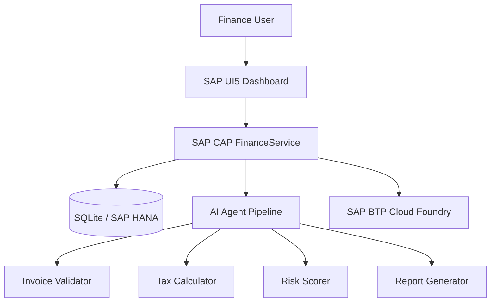

<!-- loio9a752eb644b94b9588ffcdaaf91cea2d -->

# Finance Intelligence Dashboard Overview

The Finance Intelligence Dashboard is an enterprise-grade application built with SAP UI5 and the SAP Cloud Application Programming Model \(CAP\). It provides real-time visibility into invoice processing workflows, compliance metrics, risk alerts, and AI-driven automation across a 7-stage processing pipeline.

This documentation covers the system architecture, key capabilities, and how the frontend and backend layers interact to deliver intelligent financial operations on SAP Business Technology Platform \(BTP\).

<a name="loio9a752eb644b94b9588ffcdaaf91cea2d__section_overview"/>

## System Overview

The Finance Intelligence Dashboard combines the declarative power of SAP CAP with the rich UI capabilities of SAP UI5 to deliver a complete, full-stack finance automation solution. At its core, the application processes invoices through an AI-powered pipeline that validates, calculates taxes, scores risk, and generates reports automatically — without manual intervention.

The application is designed for finance teams who need a single consolidated view across invoice status, compliance health, and risk exposure. It surfaces AI agent activity in real time, making it easy to identify bottlenecks, flag anomalies, and take corrective action without leaving the dashboard.

For more information about SAP Cloud Application Programming Model, see [Working with the SAP Cloud Application Programming Model](https://help.sap.com/docs/HANA_CLOUD_DATABASE/b9902c314aef4afb8f7a29bf8c5b37b3/166f4fbbcbc64df3bd74220fd75c5b1e.html "SAP CAP development model overview on SAP Help Portal") :arrow_upper_right:.

<a name="loio9a752eb644b94b9588ffcdaaf91cea2d__section_architecture"/>

## System Architecture

The application follows a three-tier architecture: an SAP UI5 frontend, an SAP CAP service layer, and a database tier backed by SQLite in development and SAP HANA in production. All tiers are packaged together as a Multi-Target Application \(MTA\) for deployment to SAP BTP Cloud Foundry.

**System Components**

<table>
<tr>
<th valign="top">

Component

</th>
<th valign="top">

Role

</th>
<th valign="top">

Technology

</th>
</tr>
<tr>
<td valign="top">

Finance Dashboard UI

</td>
<td valign="top">

Frontend application with XML views, fragments, and controllers

</td>
<td valign="top">

SAP UI5 \(MVC, XML views\)

</td>
</tr>
<tr>
<td valign="top">

FinanceService

</td>
<td valign="top">

OData V4 service exposing all business entities

</td>
<td valign="top">

SAP CAP \(CDS, Node.js\)

</td>
</tr>
<tr>
<td valign="top">

Database Layer

</td>
<td valign="top">

Stores invoices, compliance scores, alerts, and trend data

</td>
<td valign="top">

SQLite \(development\), SAP HANA \(production\)

</td>
</tr>
<tr>
<td valign="top">

AI Agent Framework

</td>
<td valign="top">

Validates, calculates tax, scores risk, and generates reports on invoices

</td>
<td valign="top">

Node.js microservices

</td>
</tr>
<tr>
<td valign="top">

MTA Deployment

</td>
<td valign="top">

Packages and deploys all modules to SAP BTP Cloud Foundry

</td>
<td valign="top">

MTA \(mta.yaml\), Cloud Foundry CLI

</td>
</tr>
</table>

> ### Note:  
> The diagram above is a Mermaid representation for reference. For SAP Help Portal publishing, replace this code block with an exported PNG image in the `images/` folder: ``

<a name="loio9a752eb644b94b9588ffcdaaf91cea2d__section_key_features"/>

## Key Features

The Finance Intelligence Dashboard delivers the following capabilities:

-   Real-time invoice processing status across a 7-stage pipeline with visual flow connectors
-   AI-driven validation, tax calculation, risk scoring, and automated report generation
-   Compliance score breakdown by category with progress indicators and percentage display
-   KPI cards for processed invoices, auto-calculated tax, compliance exceptions, and flagged anomalies
-   Monthly trend chart for historical invoice volume analysis with interactive bar visualization
-   Severity-based alert system with High, Medium, and Low classification and color-coded indicators
-   Invoice detail dialog with AI verdict, risk level, validation errors, and approve/reject actions
-   Fully responsive design supporting desktop, laptop, tablet, and mobile viewports

For an overview of SAP Fiori dashboard design guidelines, see [Dashboards](https://help.sap.com/docs/SAP_S4HANA_ON-PREMISE/22bbe89ef68b4d0e98d05f0d56a7f6c8/2dd576ddc273492888b8b01a8568194f.html "SAP Fiori dashboard design and implementation guide") :arrow_upper_right:.

<a name="loio9a752eb644b94b9588ffcdaaf91cea2d__section_design_principles"/>

## Design Principles

The application is built on three guiding principles: transparency, automation, and responsiveness.

Transparency means every invoice carries a visible score, risk level, and AI verdict — nothing is processed silently. Finance users can drill into any invoice to see exactly what the AI assessed and why. Automation means the AI agent pipeline handles validation, tax calculation, and risk scoring without manual intervention, reducing human error and shortening cycle times. Responsiveness means the SAP Horizon theme and fluid grid layout ensure the dashboard renders correctly across device sizes, from large enterprise monitors to mobile devices.

**Related Information**  

[Data Model](data-model-b3d77c9.md "CDS entity definitions and data structure")

[OData Service Layer](odata-service-2352883.md "FinanceService endpoints and service implementation")

[UI Components](ui-components-53ad056.md "SAP UI5 views, fragments, and controllers")

[AI Agents and Processing Pipeline](ai-agents-pipeline-641aad7.md "AI agent roles and 7-stage pipeline description")

[Deployment Guide](deployment-guide-e5eb8f5.md "Local development setup and SAP BTP deployment instructions")

[Working with the SAP Cloud Application Programming Model](https://help.sap.com/docs/HANA_CLOUD_DATABASE/b9902c314aef4afb8f7a29bf8c5b37b3/166f4fbbcbc64df3bd74220fd75c5b1e.html "SAP CAP overview on SAP Help Portal") :arrow_upper_right:
